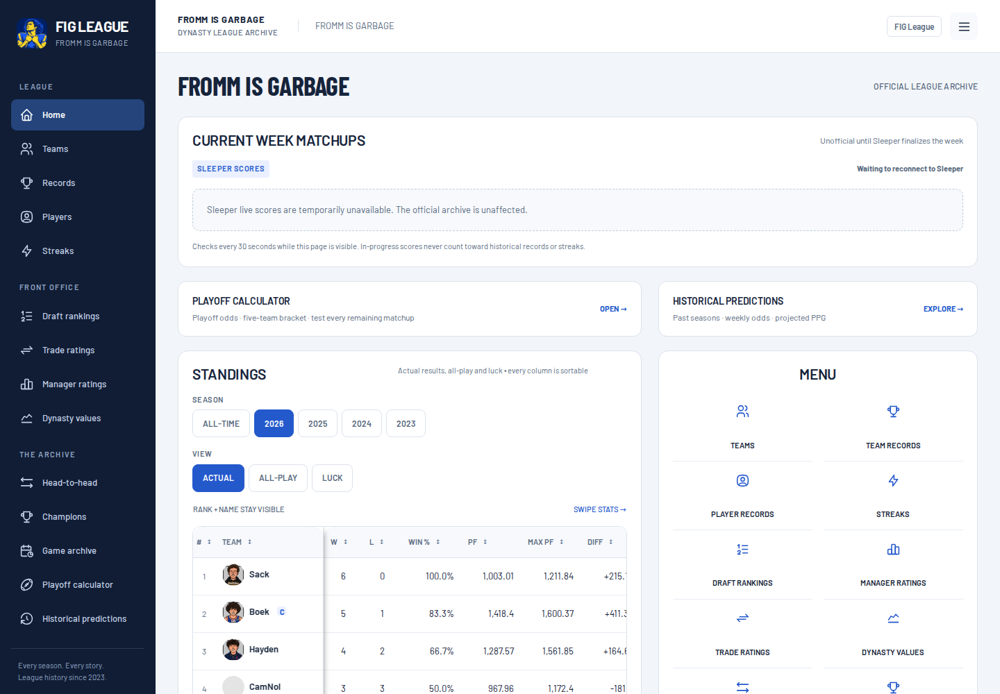
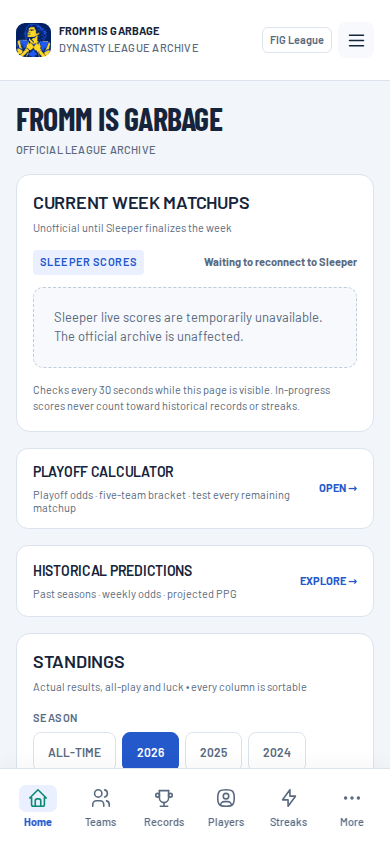
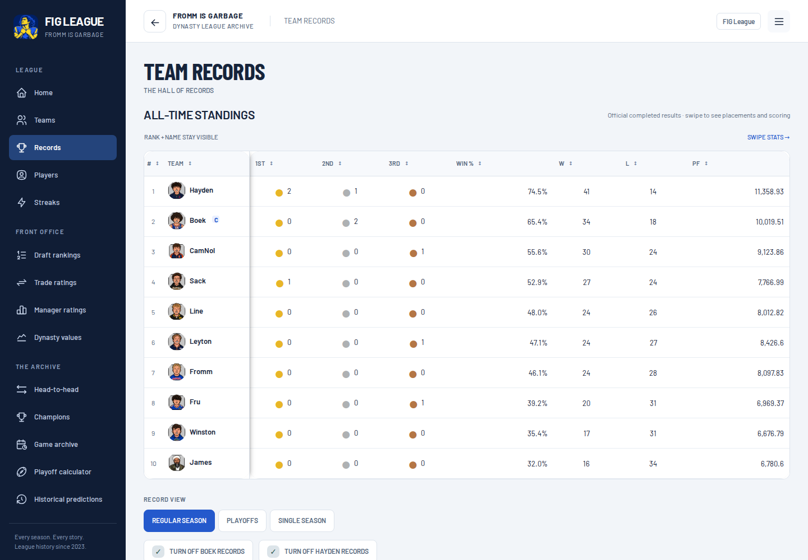
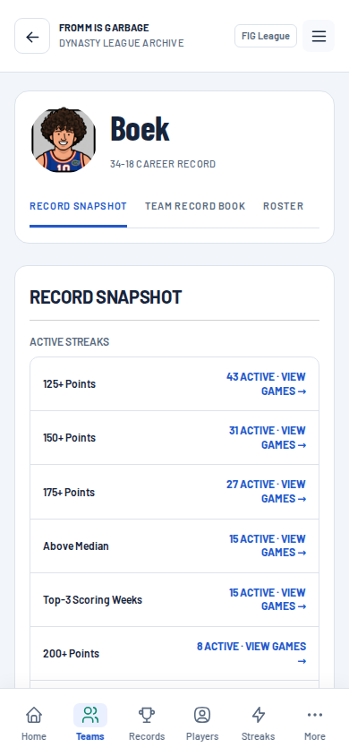
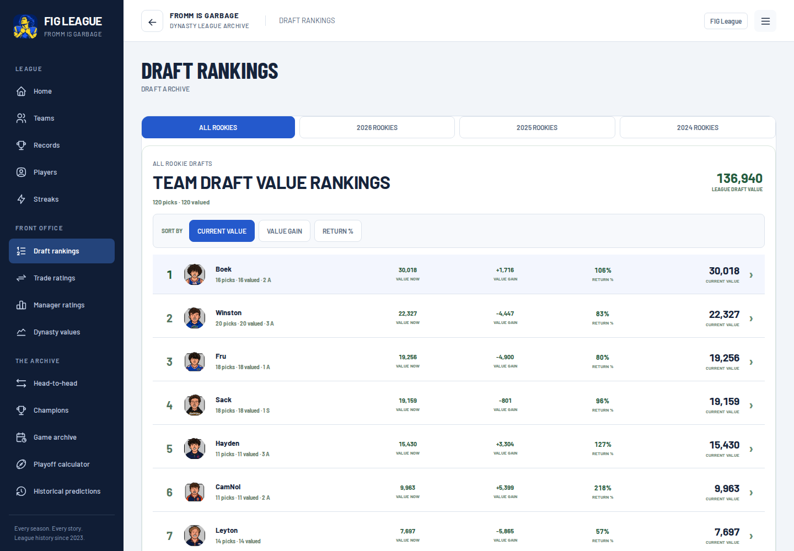
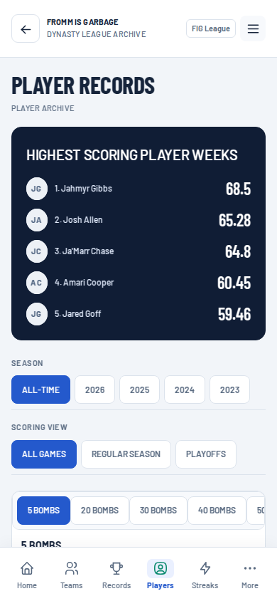

# FIG League UI overhaul review

Branch: `design/fig-platform-overhaul`. This change is for review; it is not merged or deployed.

The existing hash-router application now uses a shared broadcast scorebook design: navy navigation, cool silver backgrounds, white data surfaces, royal blue controls, self-hosted Barlow typography, and Tabler icons. The desktop rail and mobile dock reach every existing section. All existing renderers, routes, data sources, calculations, filters, exclusions, and drilldown links remain in place.

## Screens

These captures use actual archived league data. The test environment could not reach external Sleeper/headshot endpoints, so the home screen shows its genuine reconnect state and some player images show initials. The live-score path was separately tested with an explicitly synthetic API fixture.

| Desktop | Mobile |
|---|---|
|  |  |
|  |  |
|  |  |

## Implementation

- `ui-platform.css` provides typography, surfaces, controls, tables, scoreboards, player/franchise profiles, record galleries, drafts, trades, manager ratings, playoffs, and responsive layouts.
- `ui-platform.js` provides icons, route loading states, accessible focus/announcements, contextual browser-history navigation, restored filters/scroll position, and restrained transitions. Historical numbers remain static; only changed live scores receive feedback.
- The existing app router calls two UI lifecycle hooks. A loading timeout cannot detach an already-mounted asynchronous calculator shell. Explicit week links retain their destination scroll position.
- Franchise tabs sit directly beneath the identity; their content comes before the retained career-stat and valuation summary. Record lists use separators, and specialist trade/draft/waiver components share the same controls and metadata scale.
- Narrow scroll-into-view changes respect reduced motion. No statistics, models, ranking math, or data-generation scripts were rewritten.
- Safe-area padding and `viewport-fit=cover` support standalone iPhone use. The existing manifest and icons are unchanged. The worker continues to use network-first shell requests and never caches league JSON; new CSS/JS/fonts join its shell cache.
- No new application framework or runtime package is required. The Pages staging script still produces one fingerprinted CSS bundle.

## Verification

| Check | Result |
|---|---|
| Baseline discovery | 34 named route families; 423 concrete archived routes |
| Route and link comparison | 846 desktop/mobile checks; no lost baseline links or page errors |
| Responsive layout | No document-level horizontal overflow in route sweep; 320, 390, 768, and 1440px shell checks |
| Visual captures | 35 representative screens at desktop and mobile, plus franchise tabs and narrow/tablet views |
| Browser interactions | 12 passing cases: filters, sorts, frozen-row alignment, history/scroll restoration, all seven team tabs, searches, exclusions, draft/trade pagination, lineup game, calculator editor, keyboard focus, reduced motion |
| Delivery and async behavior | Six passing checks: staged bundle/fonts, shell cache, offline shell with uncached JSON, synthetic live-score refresh, slow calculator request, week-link scrolling |
| Existing JavaScript regression suites | Seven passing suites |
| Existing Python suite | 115 passing of 121; the same six failures reproduce on unchanged `main` |
| Data/architecture comparison | No redesign changes to `data/`, data builders, workflows, manifest, app icons, or statistical methodologies |

The six existing Python failures are in the cache-version string expectation, missing-rookie-value expectation, RosterAudit CSV fixture, scoring-streak source-string expectation, trade-archive source-string expectation, and Loveland trade-lineage expectation. They are not hidden or treated as passing.

The route/link baseline was captured from `a5ad19b`; the 846-route sweep and visual review used `8bbeb32`. Before publication, the branch incorporated upstream roster/value snapshots and refresh-validation improvements through `8461232`. The interface source was unchanged by those upstream updates. JavaScript, browser-interaction, and Python checks were repeated against the updated base; existing Python failures were also reproduced on that base.

Independent Impeccable visual review: **SHIP** after two bounded correction rounds. The reviewer confirmed contrast, mobile scoreboard spacing, franchise-tab consistency, portrait geometry, flat record lists, early tab access, and lineup/draft label legibility. No material findings remain from the agreed review batch. The reviewer inspected screenshots and source; automated tests were run by the implementation agent. Physical iPhone/Safari installation, actual status-bar/home-indicator insets, and real external API access remain device/environment acceptance checks. Browser viewport emulation is not a claim of hardware testing.

## Run locally

From this branch, serve the repository with `python3 -m http.server 8000` and open `http://localhost:8000/#/home`. Avoid opening `index.html` directly because the application fetches local JSON.

For the production-shaped artifact, run `bash scripts/stage_pages.sh /tmp/fig-review`, then serve that directory. This stages files locally and does not deploy.

Optional browser checks require Playwright in the development environment, not in the shipped site:

```sh
node tests/test_ui_platform.cjs
UI_SITE_DIR=/tmp/fig-review node tests/test_ui_delivery.cjs
```

Set `CHROMIUM_EXECUTABLE` if using a system Chromium and `UI_REPORT` to save a JSON report. The delivery suite intentionally uses synthetic Sleeper fixtures and does not write league records.
